# youPace - AI-Powered Personal Health & Fitness Ecosystem

Welcome to **youPace**, an advanced, AI-powered health and fitness tracking ecosystem. This repository serves as the central monorepo orchestrating the backend API service, frontend single-page application, workflow automation pipeline, and DevOps infrastructure.

---

## 🏗️ Project Architecture Overview

```mermaid
graph TD
    User[Client Browser] -->|React SPA| Frontend[Frontend - React/Vite]
    Frontend -->|HTTPS API Requests| Backend[Backend - Go/Echo]
    Backend -->|CRUD Operations| DB[(PostgreSQL)]
    Backend -->|Caching & Sessions| Cache[(Redis)]
    Backend -->|AI Analysis & Chat| Gemini[Google Gemini API]
    Backend -->|Workflow / Integration| n8n[n8n Automation]
    n8n -->|Calendar Operations| GoogleCalendar[Google Calendar API]
    Jenkins[Jenkins CI/CD] -->|Deploys / Runs| Docker[Docker Containers]
```



### Repository Structure
*   **[`/backend`](file:///c:/Users/Soranut/Desktop/YourPaceEnv/backend)**: RESTful API service built with Go (Golang) and Echo framework.
*   **[`/frontend`](file:///c:/Users/Soranut/Desktop/YourPaceEnv/frontend)**: Client application built with React and Vite.
*   **`docker-compose.yml`**: Multicontainer orchestration configuration for local development and staging.
*   **`Jenkinsfile` & `Dockerfile.jenkins`**: Continuous Integration and Deployment configurations.

---

## 🛠️ Tech Stack & DevOps Ecosystem

*   **Backend:** Go (Echo, GORM, Go-JWT)
*   **Frontend:** React (Vite, CSS Modules)
*   **Databases:** PostgreSQL 15 (Relational storage), Redis 7 (Caching & session logs)
*   **AI Integration:** Google Gemini 1.5 Flash (API)
*   **Integrations & Automation:** n8n Webhook workflows, Google Calendar API
*   **CI/CD Pipeline:** Jenkins (Pipelines), SonarQube (Static Code Quality Assessment)
*   **Deployment:** Docker, Docker Compose

---

## 🚀 Local Development Setup

To run the complete ecosystem locally, ensure you have **Docker** and **Docker Compose** installed on your system.

### 1. Configure Environment Variables
Copy the backend `.env.example` to create your local configurations:
```bash
cp backend/.env.example backend/.env
```
Fill in the required credentials in `backend/.env` (specifically `GEMINI_API_KEY`, `GOOGLE_CLIENT_ID`, and `GOOGLE_CLIENT_SECRET`).

### 2. Launch Services with Docker Compose
From the root directory, spin up all services (PostgreSQL, Redis, Backend Go API, React Frontend, and n8n) using:
```bash
docker-compose up -d --build
```

### 3. Service Ports map:
*   **React Frontend:** [http://localhost:3000](http://localhost:3000)
*   **Go API Backend:** [http://localhost:8081](http://localhost:8081)
*   **n8n Workflow Automation:** [http://localhost:5678](http://localhost:5678)
*   **PostgreSQL Database:** `localhost:5432`
*   **Redis Cache:** `localhost:6380` (Internal port `6379`)
*   **Jenkins CI Server:** [http://localhost:8085](http://localhost:8085)

---

## 🔄 CI/CD & Code Quality Integration

This project uses **Jenkins** and **SonarQube** to automate testing, build verification, and code quality checking.

*   **Continuous Integration:** The `Jenkinsfile` defines a pipeline that automatically pulls code changes, runs unit tests for both frontend and backend services, runs static analysis, and builds production-ready Docker containers.
*   **Code Quality & Security:** **SonarQube** scans the project against pre-defined rules, warning about code smells, potential bugs, coverage gaps, and exposed vulnerabilities. Configuration details can be found in `sonar-project.properties`.
