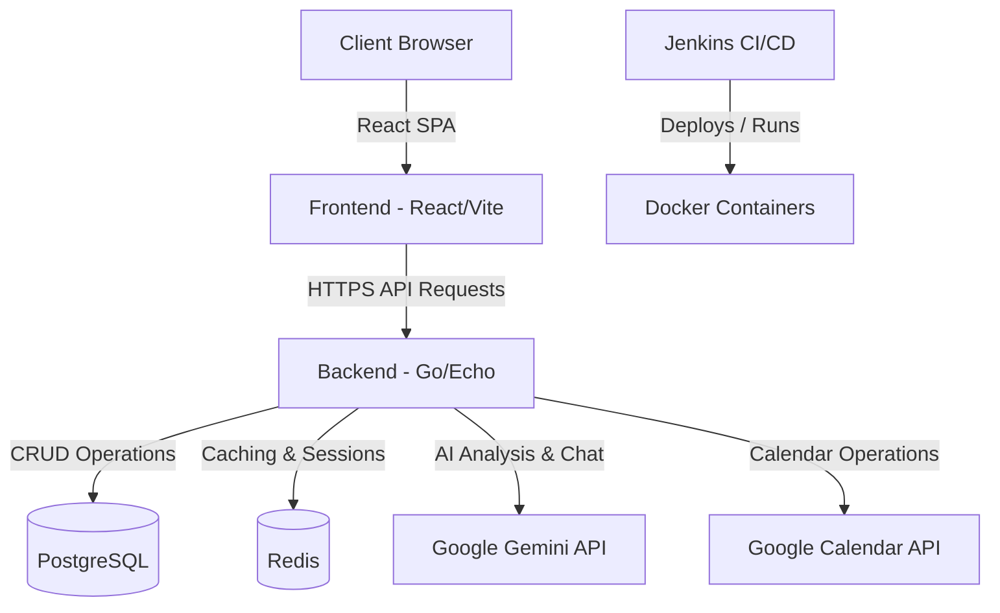

# youPace - AI-Powered Personal Health & Fitness Ecosystem

Welcome to **youPace**, an advanced, AI-powered health and fitness tracking ecosystem. This repository serves as the central monorepo orchestrating the backend API service, frontend single-page application, workflow automation pipeline, and DevOps infrastructure.

> 🌐 **Live demo / เดโมออนไลน์**
> - Frontend (Vercel): <https://yourpace-topaz.vercel.app>
> - Backend API (Render): <https://yourpace-backend.onrender.com> - health check: <https://yourpace-backend.onrender.com/health>
>
> Render's free plan sleeps when idle, so the first request can take a while. / แพ็กเกจฟรีของ Render จะหลับเมื่อไม่มีการใช้งาน คำขอแรกอาจช้า

### 📊 At a glance / สรุปผลโดยย่อ

| | Result / ผลลัพธ์ | How it was measured / วิธีวัด |
| --- | --- | --- |
| Backend tests (Go) | **93.9%** statement coverage | `cd backend && go test ./... -coverprofile=cover.out && go tool cover -func=cover.out` |
| Frontend tests (Vitest) | **94.4%** lines, **82.4%** branches (92.8% statements, 89.7% functions) | `cd frontend && npm run test:coverage` (CI-style gate: fails under 80% lines or branches) |
| CI (Jenkins) | Checkout, then Code Quality & Linting (backend and frontend in parallel), Backend Tests, Frontend Tests, SonarQube Analysis, Build & Deploy Containers | [`Jenkinsfile`](Jenkinsfile) |
| Load test (k6, 50 virtual users, everything on one laptop) | 15-20 s runs on a fresh DB: **437 req/s**, avg 93 ms, p95 249 ms, p99 376 ms, **0% errors** | single runs, read endpoints, short duration |
| | 60 s runs: 414-441 req/s, p95 246-253 ms, but **3 of 4 runs had 13-22% errors** (see Known issues) | errors are fast, so throughput in those runs is optimistic |

### ⚠️ Known issues / ปัญหาที่ทราบ

*   **Water-log race (fixed, not yet re-load-tested):** the 60 s load runs logged 113 `duplicate key ... "idx_user_water_date"` errors, caused by many simultaneous requests creating the same user's water-log row for the day (`GET/POST /api/water/today`). Row creation now uses `INSERT ... ON CONFLICT DO NOTHING` and reads the winning row (`createWaterLogOnce` in `backend/handlers/water.go`, with a unit test). I verified it with the unit tests only; the 60 s k6 run has not been repeated, so the error rate has not been re-measured.
*   **Unexplained load-test errors:** in the same 60 s runs some requests that succeed one at a time returned 401/404, and `health/weight/history` returned a 500 at the start of the failures. The cause has not been found, so do not read the 60 s numbers as clean.
*   **Load-test scope:** the figures come from one laptop, single runs, and a read-heavy workload; they show the order of magnitude, not a capacity claim.
*   **Coverage gaps:** `InitDB`, `RunMigrations` and `main()` need a real PostgreSQL and are not covered by the default (SQLite) test run.

---

## 🏗️ Project Architecture Overview



### Repository Structure
*   **[`/backend`](backend)**: RESTful API service built with Go (Golang) and Echo framework.
*   **[`/frontend`](frontend)**: Client application built with React and Vite.
*   **`docker-compose.yml`**: Multicontainer orchestration configuration for local development and staging.
*   **`Jenkinsfile` & `Dockerfile.jenkins`**: Continuous Integration and Deployment configurations.

---

## 🛠️ Tech Stack & DevOps Ecosystem

*   **Backend:** Go (Echo, GORM, Go-JWT)
*   **Frontend:** React (Vite, CSS Modules)
*   **Databases:** PostgreSQL 15 (Relational storage), Redis 7 (Caching & session logs)
*   **AI Integration:** Google Gemini Flash-Lite (API, model set by `GEMINI_URL`)
*   **Integrations:** Google Calendar API
*   **CI/CD Pipeline:** Jenkins (Pipelines), SonarQube (Static Code Quality Assessment)
*   **Deployment:** Docker, Docker Compose

---

## 🚀 Local Development Setup

To run the complete ecosystem locally, ensure you have **Docker** and **Docker Compose** installed on your system.

### 1. Configure Environment Variables
Copy the root `.env.example` to create your local configurations:
```bash
cp .env.example .env
```
Fill in the required credentials in `.env` (`POSTGRES_PASSWORD`, `JWT_SECRET`, and specifically `GEMINI_API_KEY`, `GOOGLE_CLIENT_ID`, and `GOOGLE_CLIENT_SECRET`).

### 2. Launch Services with Docker Compose
From the root directory, spin up all services (PostgreSQL, Redis, Backend Go API, and React Frontend) using:
```bash
docker-compose up -d --build
```

### 3. Service Ports map:
*   **React Frontend:** [http://localhost:3000](http://localhost:3000)
*   **Go API Backend:** [http://localhost:8081](http://localhost:8081)
*   **PostgreSQL Database:** `localhost:5432`
*   **Redis Cache:** `localhost:6380` (Internal port `6379`)
*   **Jenkins CI Server:** [http://localhost:8085](http://localhost:8085)


### Deploying and account setup
Step-by-step instructions for Render, Vercel, Google OAuth, Jenkins and reminder emails are in [docs/SETUP-CHECKLIST.md](docs/SETUP-CHECKLIST.md).

### 4. Database backup & restore
With the compose stack running:
```bash
./scripts/backup-postgres.sh                                  # writes backups/youpace-<timestamp>.sql, keeps the newest 14
./scripts/backup-postgres.sh --restore backups/<file>.sql      # restore (drops and recreates objects)
```
On Windows use `.\scripts\backup-postgres.ps1` (`-Restore <file>`). The `backups/` folder is git-ignored because it contains user data.

---

## 🔄 CI/CD & Code Quality Integration

This project uses **Jenkins** and **SonarQube** to automate testing, build verification, and code quality checking.

*   **Continuous Integration:** The `Jenkinsfile` defines a pipeline that automatically pulls code changes, runs unit tests for both frontend and backend services, runs static analysis, and builds production-ready Docker containers.
*   **Code Quality & Security:** **SonarQube** scans the project against pre-defined rules, warning about code smells, potential bugs, coverage gaps, and exposed vulnerabilities. Configuration details can be found in `sonar-project.properties`.

### Test coverage

Both halves of the project must keep **line coverage above 80%**; the frontend also enforces **branch coverage of at least 80%** (Go has no branch metric).

| Part | Command | Report |
| --- | --- | --- |
| Backend (Go) | `cd backend && go test ./... -coverprofile=cover.out && go tool cover -func=cover.out` (last line is the total) | `go tool cover -html=cover.out` |
| Backend, with a pass/fail gate | `scripts/backend-coverage.sh` (set `COVERAGE_THRESHOLD` to change the 80% default) | prints the total |
| Frontend (Vitest) | `cd frontend && npm run test:coverage` (fails below the 80% line or branch threshold in `vite.config.js`) | `frontend/coverage/` |

The backend tests need no Docker: handler tests run against an in-memory SQLite database,
with in-process fakes for Redis, Gemini and Google. To run them against real PostgreSQL
instead, set `TEST_DATABASE_URL` (key=value form, for example
`host=localhost port=5432 user=postgres password=test dbname=youpace_test sslmode=disable`).
The Postgres-only tests for the SQL migrations and advisory lock are skipped without it.
